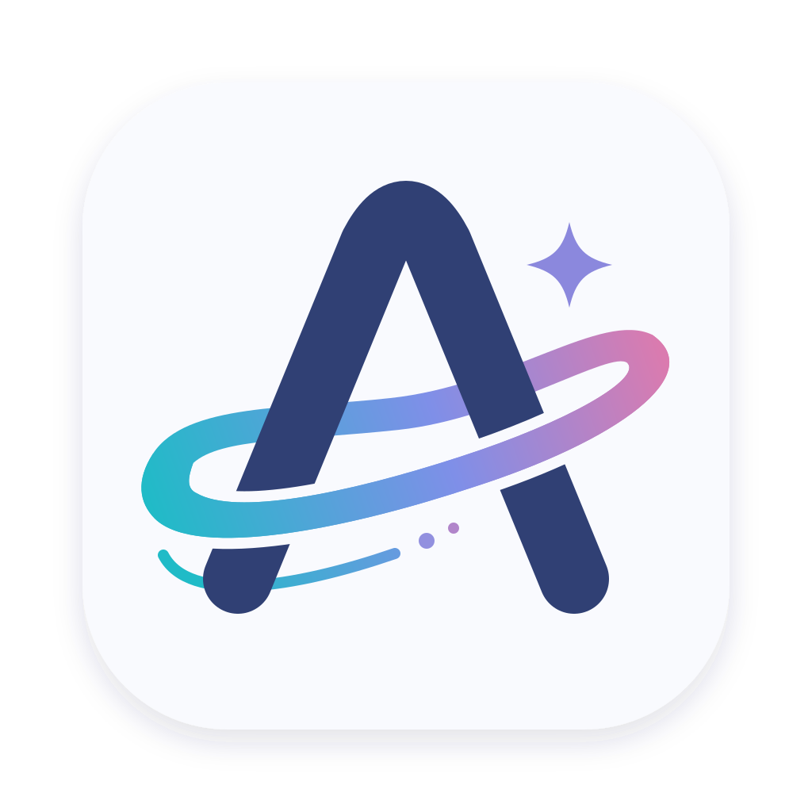
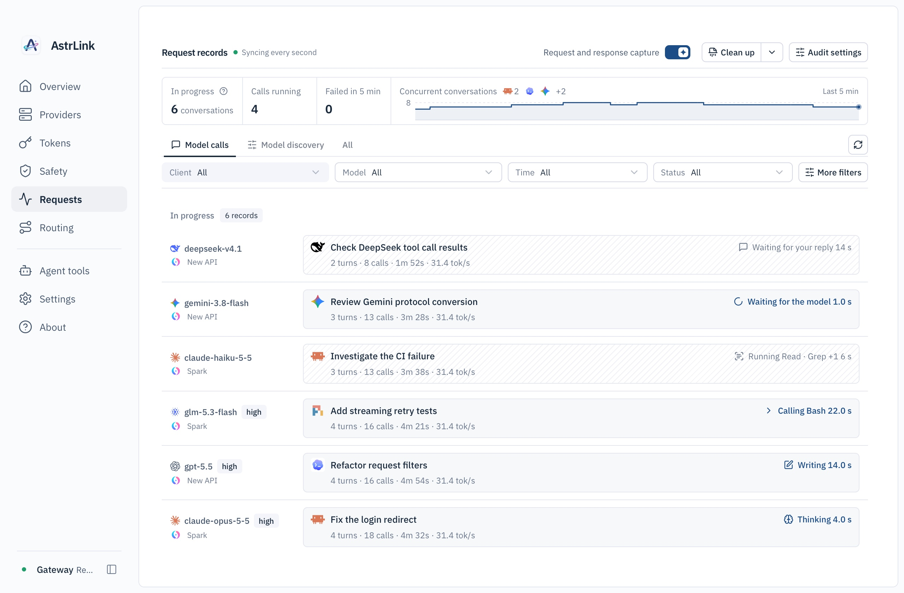
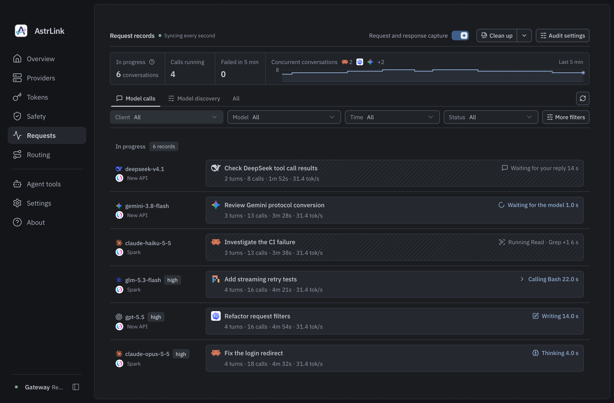
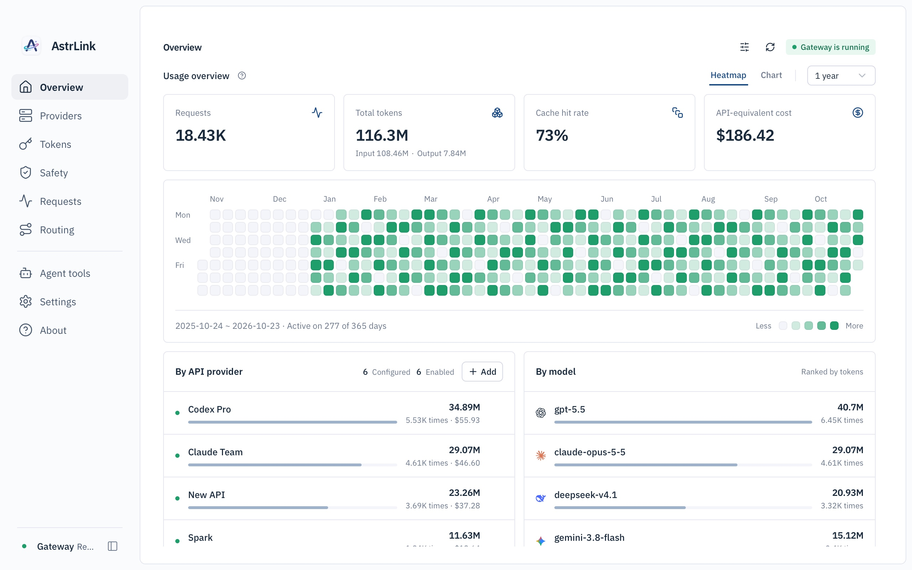
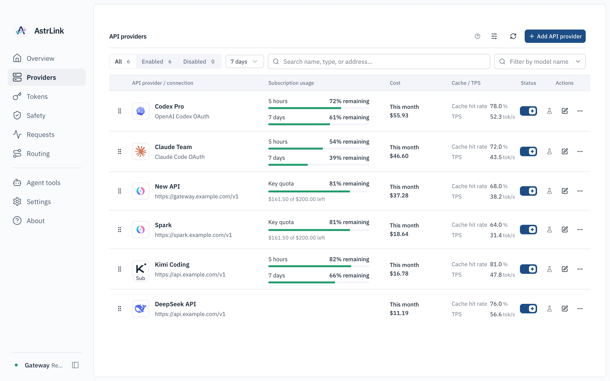
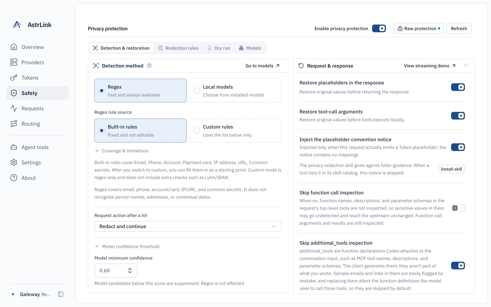
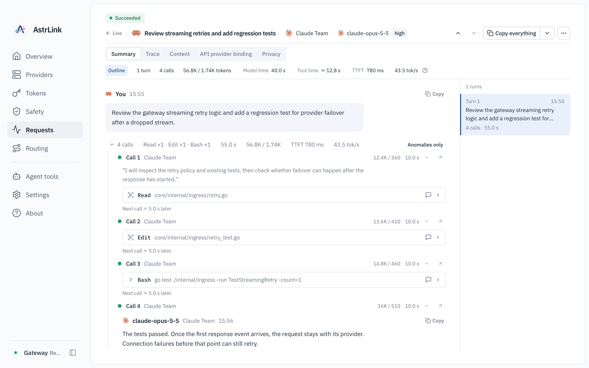

<!-- markdownlint-configure-file {
  "MD013": { "tables": false },
  "MD033": { "allowed_elements": ["p", "img"] },
  "MD041": false
} -->

  

# AstrLink

[English](README.md) | [简体中文](README.zh-CN.md) | **日本語**

**AI
Agent 向けのローカルプライバシーゲートウェイ。モデルへ送る前に、機密内容をローカルで検出してマスキングします。**

AstrLink は macOS、Windows、Linux 向けのオープンソースデスクトップアプリです。  
リクエストがアップストリームへ送られる前に、機密内容をローカルで検出します。  
対象はシークレット、メールアドレス、電話番号などです。  
ポリシーに従って、警告、ブロック、またはマスキングできます。  
マスキングした値はレスポンス側でローカルに復元できるため、Agent は作業を続けられます。  
既存のサブスクリプションと API をまとめて接続し、ルーティングとリクエスト記録も扱います。

[開始手順](#開始手順) ·
[ローカルでのプライバシー保護](#ローカルでのプライバシー保護) ·
[利用ガイド（中国語）](docs/guides/README.md) ·
[開発への参加（中国語）](CONTRIBUTING.md)

## スクリーンショット

現在の画面を掲載しています。アカウント、利用量、費用、リクエスト内容はいずれも模擬データです。画像をクリックすると原寸で表示されます。画面は英語表示です。[幅の狭いウィンドウでの表示](assets/screenshots/requests-compact.en.jpg)も確認できます。

| リアルタイムのリクエスト · ライトテーマ                                                                                                          | リアルタイムのリクエスト · ダークテーマ                                                                                                        |
| ------------------------------------------------------------------------------------------------------------------------------------------------ | ---------------------------------------------------------------------------------------------------------------------------------------------- |
|  |  |
| **概要**                                                                                                                                         | **API プロバイダー**                                                                                                                           |
|                                                   |         |
| **ローカルでのプライバシー保護**                                                                                                                 | **リクエストの詳細**                                                                                                                           |
|                                 |   |

## 機能

- **ローカルでのプライバシー保護**:

  ローカルのルールまたはローカルのプライバシーモデルで機密内容を検出します。ポリシーに従って警告、ブロック、またはマスキングし、必要に応じてレスポンス内のプレースホルダーを復元します。

- **サブスクリプションと API をまとめて接続**:
  Codex、Claude、Grok のサブスクリプション、主要な API プロバイダー、Coding
  Plan、New
  API などの互換ゲートウェイを接続し、アカウントと資格情報を集中管理します。
- **モデルルーティング**: リクエストされたモデル名を対象モデルへリダイレクトし、APIプロバイダーの優先度、再試行、フェイルオーバーを設定します。
- **複数の API プロトコル**: OpenAI Responses、Chat Completions、Anthropic
  Messages、Gemini のエンドポイントを提供し、アップストリームの能力に合わせてプロトコル変換を設定できます。
- **リクエスト記録と利用状況**:

  リクエスト、セッションの軌跡、アップストリームへの試行、エラーを確認します。利用量と費用の見積もりを、APIプロバイダー、モデル、アクセストークンごとに集計します。

## ローカルでのプライバシー保護

プライバシーポリシーを有効にすると、AstrLink は機密内容の検出、リクエストのマスキング、レスポンスの復元をローカルで行えます。

1. **端末上で検出する**:  
   組み込みルール、カスタムルール、またはローカルのプライバシーモデルで識別します。  
   対象はシークレット、メールアドレス、電話番号などの機密内容です。  
   ルールによる検出に、モデルのダウンロードは不要です。
2. **ポリシーを適用する**:  
   警告、ブロック、マスキングから選びます。  
   マスキングは、検出した機密内容をプレースホルダーに置き換えます。  
   検出の種類と許可リストを設定し、ドライランで結果を確認します。
3. **必要なときレスポンスを復元する**:  
   レスポンスの復元を有効にすると、モデルが返したプレースホルダーを元の値に戻します。  
   Agent はその結果を引き続き使えます。

ゲートウェイ、プライバシー検出、マスキングは端末上で動きます。推論リクエストは、設定したアップストリームの  
APIプロバイダーへ送信されます。実際の処理は、有効なポリシーと検出結果により決まります。リクエスト本文のキャプチャは既定でオフであり、調査のときだけ別に有効にできます。

ローカルのプライバシーモデルは、ダウンロードまたはインポートが必要です。手順は[プライバシーモデルの設定（中国語）](apps/desktop/README.md#隐私模型)を参照してください。思考署名や暗号化された継続データについては、[プライバシー検出と継続の互換性（中国語）](docs/guides/privacy-reasoning-continuation.md)を参照してください。

## インストール

AstrLink は開発の初期段階にあり、公式のインストーラーはまだ公開されていません。公開版は
[Releases](https://github.com/Calcium-Ion/AstrLink/releases) に置かれます。

現在は[開発とビルドの手順（中国語）](CONTRIBUTING.md)に従って、ソースから実行できます。GitHub にサインインした状態で、成功した
[Actions](https://github.com/Calcium-Ion/AstrLink/actions)
の実行からビルド成果物をダウンロードすることもできます。これらは開発ビルドであり、署名や公証がされていない場合があります。

| プラットフォーム | パッケージと要件                                                                              |
| ---------------- | --------------------------------------------------------------------------------------------- |
| macOS            | Apple Silicon / Intel、macOS 13.4 以降                                                        |
| Windows          | x64 `.exe` インストーラー。インストール中に WebView2 のダウンロードが必要になる場合があります |
| Linux            | x64 `.deb`、Debian 12 または互換性のある新しいディストリビューション                          |

ローカルのプライバシーモデルは別途ダウンロードまたはインポートします。モデルの重みは、アプリのパッケージに含まれません。

## 開始手順

### 1. サブスクリプションまたは API を接続する

AstrLink を開き、ゲートウェイが動作していることを確認してから、**APIプロバイダー**
で既存のサブスクリプションまたは API を追加します。

| サブスクリプションまたは API                                               | 接続方法                                                                                   |
| -------------------------------------------------------------------------- | ------------------------------------------------------------------------------------------ |
| Codex、Claude、Grok のサブスクリプション                                   | サブスクリプションの種類を選び、認可の手順に従います。Grok は Device Code でログインします |
| New API または他の互換ゲートウェイ                                         | ゲートウェイの URL と APIキーを入力します                                                  |
| OpenAI、Anthropic、Gemini、DeepSeek、Qwen、Kimi、GLM、MiniMax、Doubao、xAI | 従量課金 API からプロバイダーを選び、APIキーを入力します                                   |
| Coding Plan のサブスクリプション                                           | 対応する Coding Plan を選び、そのサブスクリプション専用の資格情報を使います                |

保存したあと、使うモデルを取得するか、手動で追加します。**モデル一覧が空のAPIプロバイダーは、推論リクエストを処理しません。**
API と Coding Plan  
では資格情報とエンドポイントが異なる場合があります。詳細は[APIプロバイダーの接続ガイド（中国語）](docs/guides/pay-as-you-go-providers.md)を参照してください。

モデルの利用可否、クォータ、課金は、アカウントまたはプロバイダー側の条件によります。AstrLinkの費用見積もりは参考値です。請求額は、プロバイダーの請求が基準です。

### 2. アクセストークンを作成する

**トークン**
で Agent 用のアクセストークンを作成します。Agent をローカルゲートウェイへ接続するときは、このトークンを使います。アップストリームの APIキーは
**APIプロバイダー** で設定します。

Agent ごとにトークンを分けると、利用状況の確認とアクセスの取り消しを個別に行えます。

### 3. AI Agent を接続する

**概要** または **設定** から、現在の API アドレスをコピーします。既定は
`http://127.0.0.1:8317`
です。ポートが使用中のときは変わるため、アプリに表示されたアドレスを使います。

Agent のモデル設定に、ローカルの API アドレス、アクセストークン、モデルを入力します。Chat
Completions を使う OpenAI 互換クライアントの例は次のとおりです。

| 設定     | 値                                                                                             |
| -------- | ---------------------------------------------------------------------------------------------- |
| Base URL | `http://127.0.0.1:8317/v1`。実際のポートに合わせます                                           |
| API Key  | 作成した AstrLink のアクセストークン                                                           |
| Model    | APIプロバイダーのモデル一覧にあるモデル ID、または有効なリダイレクトルールのリクエストモデル名 |

Base URL の要件はクライアントによって異なります。`/v1`
を自動で付けるものもあれば、完全なエンドポイント URL を求めるものもあります。よく使うリクエストパスは次のとおりです。

| API プロトコル          | リクエストパス                           |
| ----------------------- | ---------------------------------------- |
| OpenAI Responses        | `/v1/responses`                          |
| OpenAI Chat Completions | `/v1/chat/completions`                   |
| Anthropic Messages      | `/v1/messages`                           |
| Gemini                  | `/v1beta/models/{model}:generateContent` |

APIプロバイダーがクライアントの APIプロトコルに対応しているか、利用できるプロトコル変換を設定している必要があります。

### 4. ルーティングとプライバシーポリシーを設定する

- **ルーティング**
  でモデルのリダイレクト、再試行、フェイルオーバーを設定します。**APIプロバイダー**
  の一覧をドラッグして優先度を決めます。ゲートウェイは、対象モデルとリクエストのプロトコルに対応するAPIプロバイダーを選びます。
- **安全性**
  で検出方法と動作を選びます。日常のリクエストに使う前に、ドライランで結果を確認します。ローカルモデルは先にダウンロードまたはインポートします。
- **ルーティング**
  で、同一セッション内での APIプロバイダー再利用を有効にします。  
  バインドや再選択は、リクエスト記録で確認できます。  
  詳細は[セッションアフィニティとバインドの監査（中国語）](docs/guides/provider-stickiness.md)を参照してください。

設定が済んだらリクエストを送り、**リクエスト**
で APIプロバイダー、モデル、結果を確認します。

## よくある質問

**クライアントが認証エラーを返すのはなぜですか？**

有効な AstrLink のアクセストークンを使っているか確認します。リクエスト記録にアップストリームの 401 または 403 が出る場合は、その  
APIプロバイダーの APIキー、またはサブスクリプションのログイン状態を確認します。

**モデルが見つからない、または使える APIプロバイダーがないのはなぜですか？**

APIプロバイダーが有効か、モデル一覧に要求したモデルがあるか、有効な入口プロトコルがリクエストと一致するかを確認します。モデルのリダイレクトを使う場合は、ルールが有効か、対象モデルに対応するAPIプロバイダーがあるかを確認します。

**以前のポートに接続できなくなったのはなぜですか？**

アプリに表示されている現在の API アドレスを確認します。  
既定のポートが使用中のとき、AstrLink は空いているポートを選びます。  
設定でポートを変えたあとは、ゲートウェイを再起動します。

**プライバシーモデルを有効にしたあと、リクエストが拒否されるのはなぜですか？**

モデルがインストール済みか、ポリシーが正しく設定されているかを確認し、リクエスト記録のエラーを見ます。モデルを利用できないとき、AstrLinkは検出を省略せず、リクエストを拒否します。

**ウィンドウを閉じたあと、クライアントは使えますか？**

ウィンドウを閉じたときの設定によります。トレイに格納すると、ゲートウェイは動き続けます。アプリを終了すると、ゲートウェイは停止します。詳細は[デスクトップの設定（中国語）](apps/desktop/README.md)を参照してください。

## フィードバックと貢献

不具合は [Issues](https://github.com/Calcium-Ion/AstrLink/issues)
から報告してください。オペレーティングシステム、アプリのバージョン、再現手順、マスキングしたエラーの詳細を添えます。APIキー、アクセストークン、プライベートなリクエスト本文は、報告に含めないでください。

コードの変更やソースからのビルドは、[開発ガイド（中国語）](CONTRIBUTING.md)を参照してください。

## ライセンス

AstrLink 自身のソースコードは [Apache-2.0](LICENSE)
でライセンスされています。サードパーティのコンポーネントは、それぞれのライセンスと表記を保持します。

Core は [RelayKit](https://github.com/QuantumNous/new-api/tree/main/relaykit)
を使用しており、そのライセンスは AGPL-3.0 です。  
RelayKit を含むビルドを配布する場合、または対応する機能をネットワーク経由で提供する場合は、この依存関係のライセンス条項にも従う必要があります。
